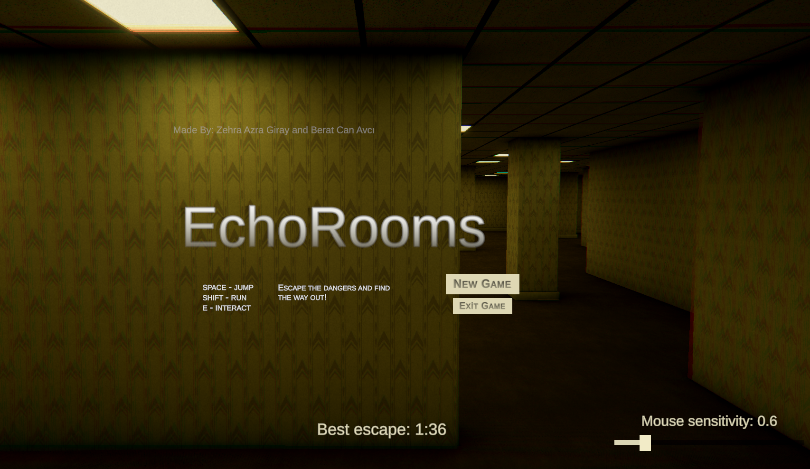
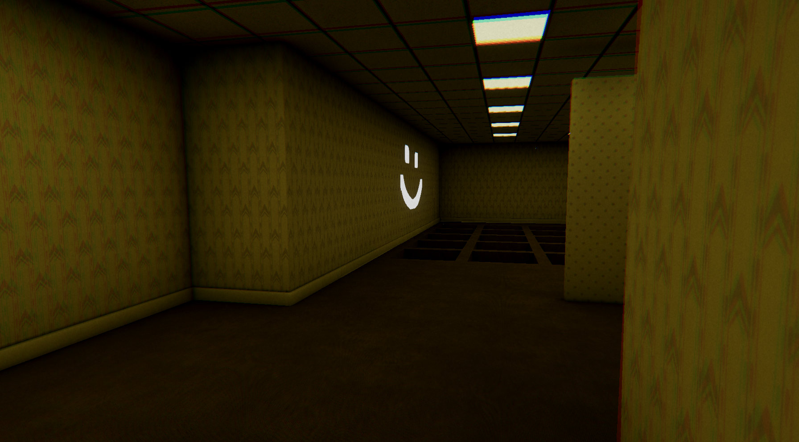
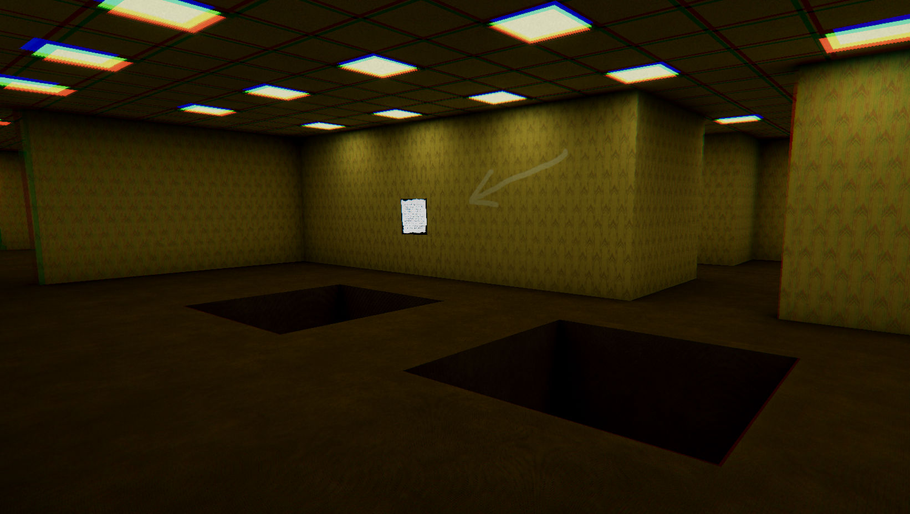
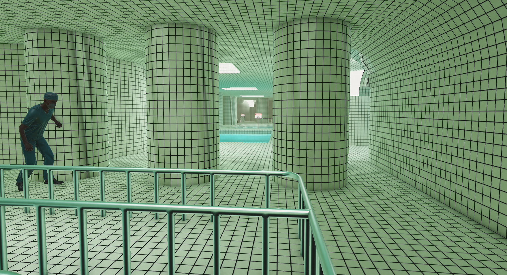
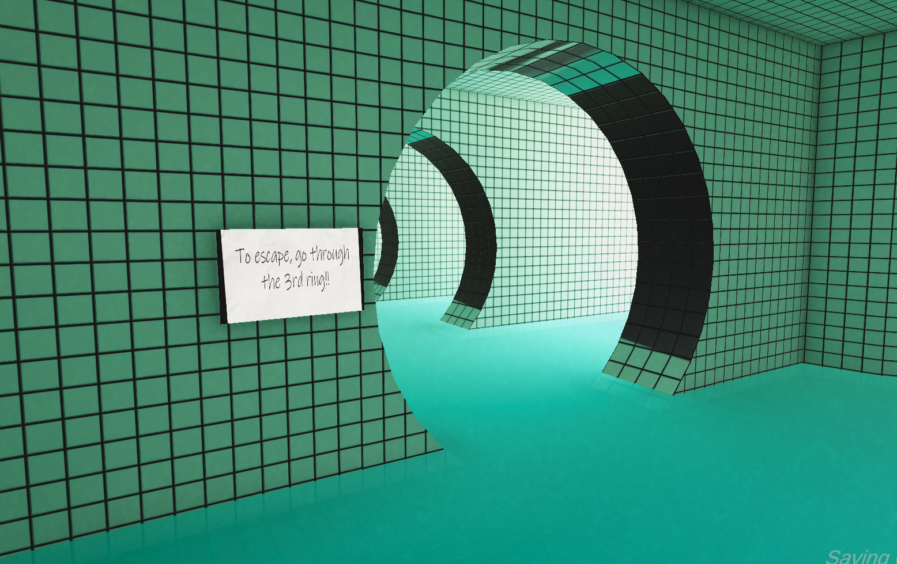

# EchoRooms

My first game project: a first-person horror game set in the Backrooms, made in Unity as my Bachelor's thesis at Pamukkale University (2025).

**Play it in the browser or download it for Windows: [zerazra7.itch.io/echorooms](https://zerazra7.itch.io/echorooms)**

  

  
  
  
  

## About the game

You wake up in the corner of an endless yellow maze. Notes scattered around the level tell the story and point you towards the right door, while a creature slowly crawls after you.

The right door takes you to the Poolrooms, a second level where you find a keycard and a portal that sends you back to the first level. The real exit is there, and the game remembers your best escape time.

## Controls

| Key | Action |
|---|---|
| WASD | Move |
| Mouse | Look around |
| Shift | Run |
| Space | Jump |
| E | Read notes (time stops while reading) |
| - / + | Mouse sensitivity (also a slider in the main menu) |

## My role

This was a two-person thesis project. I started from the demo scenes of an environment pack (see Credits) and turned them into a full game with its own story, enemy, puzzle and ending:

- **Game design:** the story told through notes, the route between the two levels, the keycard and portal loop, where the danger is
- **Enemy AI:** a crawling monster that chases the player with Unity's NavMesh, plays a sound when it gets close and kills on contact
- **Gameplay scripts (C#):** notes, keycard and exit door, ring portal with random return points, deadly pools
- **Death and ending screens:** built fully from code, with fades and sound fade-out
- **Notes:** the game stops while a note is open, so the player can read the story without the monster getting closer
- **Escape timer:** measures each run (reading time doesn't count) and saves the best time, shown in the main menu
- **Level work:** placed all game objects, added the deadly pools and warning signs, drew my own wall writings and the smiley face
- **Settings and polish:** mouse sensitivity slider and hotkeys, notes that scale to any screen size
- **Web build:** found and fixed a lighting bug that made the Poolrooms black only in the browser (empty baked lightmaps), and set up the WebGL and Windows releases on itch.io

## Built with

Unity 6 · C# · Universal Render Pipeline (URP) · NavMesh · WebGL

## Credits

- Environment: The Backrooms by Gamertose (Unity Asset Store)
- Monsters: characters and animations from Mixamo
- Sound and jumpscares: Berat Can Avcı
